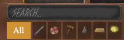
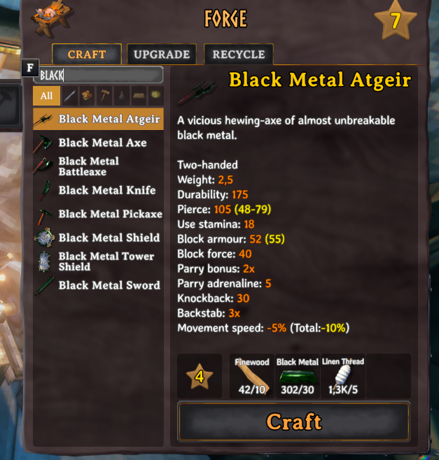

# WorkbenchSearchFilters

Mod de BepInEx para Valheim que añade un buscador y filtros por categoría (armas, armaduras, herramientas, consumibles, materiales, otros) a la lista de recetas de todas las estaciones de fabricación: mesa de trabajo, forja, forja negra, caldero, mesa de artesano, mesa de galdr... y también a la fabricación a mano.

[English version](README.md)





## Características

- **Buscador** encima de la lista de recetas: filtra mientras escribes por el nombre del objeto en el idioma del juego. No distingue mayúsculas ni tildes ("pocion" encuentra "Poción").
- **Botones de categoría:** Todo, Armas, Armaduras, Herramientas, Consumibles, Materiales, Otros. Cada botón muestra su nombre al pasar el ratón, y las categorías sin recetas en la estación actual (o para la búsqueda actual) aparecen atenuadas.
- **Escribir no controla el juego:** mientras el buscador tiene el foco, el personaje no se mueve y teclas como E o Tab no cierran el inventario.
- **Funciona en las pestañas Fabricar y Mejorar**, en todas las estaciones, también las de otros mods.
- **Traducido:** sigue el idioma del juego, también al cambiarlo en Ajustes. 22 idiomas: inglés, español, alemán, francés, italiano, portugués (Brasil y Portugal), ruso, ucraniano, polaco, checo, neerlandés, sueco, noruego, danés, finés, turco, húngaro, chino (simplificado y tradicional), japonés y coreano. Cualquier otro idioma usa el inglés.
- **Solo cliente:** no hace falta nada en el servidor y los demás jugadores no necesitan el mod.

## Categorías

Los objetos se clasifican con sus propios datos del juego, así que los objetos de otros mods se clasifican solos:

| Categoría | Qué incluye |
|---|---|
| Armas | Espadas, hachas, mazas, lanzas, alabardas, cuchillos, arcos, ballestas, bastones... |
| Armaduras | Cascos, pecheras, grebas, capas, escudos, cinturones, abalorios |
| Herramientas | Martillo, azada, cultivador, picos, caña de pescar, antorchas |
| Consumibles | Comida, hidromieles, flechas, virotes, cebos, bombas e ingredientes para el horno, la estufa o el fermentador (masa de pan, empanadas crudas, bases de hidromiel) |
| Materiales | Materiales de fabricación |
| Otros | Todo lo demás (jarras, etc.) |

Cada vez que entras en un mundo, `BepInEx/config/WorkbenchSearchFilters.adrirf7.Categories.txt` lista cada objeto fabricable con su nombre de prefab y su categoría. Para mover un objeto, añade `Prefab:Categoría` a `CategoryOverrides` en el archivo de configuración.

## Configuración

`BepInEx/config/WorkbenchSearchFilters.adrirf7.cfg`, que se crea la primera vez que se carga el mod:

- `ClearSearchOnClose` (por defecto `true`): borra la búsqueda al cerrar el inventario.
- `RememberCategory` (por defecto `true`): mantiene la categoría elegida entre aperturas.
- `CategoryOverrides`: fuerza la categoría de objetos concretos, como `Prefab:Categoría` separados por comas. Categorías: `Weapons`, `Armor`, `Tools`, `Consumables`, `Materials`, `Misc`.

## Cómo funciona

El código solo usa parches de Harmony y componentes de UI de Unity. No accede a la red ni a archivos fuera del proceso del juego, salvo para escribir su propio archivo de configuración y `WorkbenchSearchFilters.adrirf7.Categories.txt` en `BepInEx/config`.

- `src/FilterBar.cs`: crea el buscador (una copia del buscador del menú de construcción) y los botones de categoría encima de la lista de recetas, y filtra la lista. El juego monta la lista una vez; al buscar o cambiar de categoría solo se ocultan y muestran las filas existentes.
- `src/Categories.cs`: decide la categoría de cada objeto a partir de su tipo, sus valores de comida, su ataque y las estaciones de cocina del juego, y escribe el listado de categorías.
- `src/Patches.cs`: parches de Harmony en `InventoryGui.UpdateRecipeList` (filtrado), `InventoryGui.Hide` (reinicio al cerrar) y `Chat.HasFocus` (bloquea el control del juego mientras se escribe).
- `src/Translations.cs`: registra los textos del mod en la localización de Valheim.
- `src/Plugin.cs`: punto de entrada de BepInEx y configuración.

## Compilar

Requisitos:

- [.NET SDK 8](https://dotnet.microsoft.com/download) o posterior
- Valheim con [BepInExPack Valheim](https://thunderstore.io/c/valheim/p/denikson/BepInExPack_Valheim/) instalado (el proyecto usa los ensamblados del juego y de BepInEx de la carpeta de instalación)

Pasos:

```
git clone https://github.com/adrirf7/WorkbenchSearch-Filters
cd WorkbenchSearch-Filters
dotnet build -c Release -p:ValheimDir="C:\Program Files (x86)\Steam\steamapps\common\Valheim" -p:DeployToGame=false
```

El mod compilado es `bin/Release/WorkbenchSearchFilters.dll`. `ValheimDir` usa por defecto la ruta de Steam de arriba. Sin `-p:DeployToGame=false`, la compilación también copia la DLL a `BepInEx/plugins/WorkbenchSearchFilters/` en esa instalación de Valheim.

El paquete NuGet `BepInEx.AssemblyPublicizer.MSBuild` se restaura automáticamente. Permite al código acceder a miembros no públicos de `assembly_valheim.dll` al compilar, algo habitual en los mods de Valheim.

## Instalación

1. Instala BepInExPack Valheim.
2. Pon `WorkbenchSearchFilters.dll` en `BepInEx/plugins/WorkbenchSearchFilters/`.

## Cambios

- **1.0.0:** primera versión.
