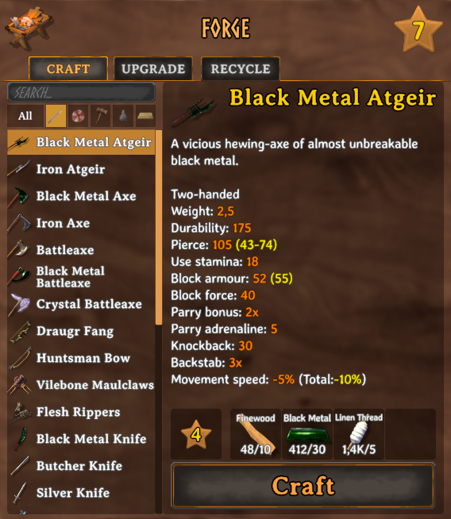
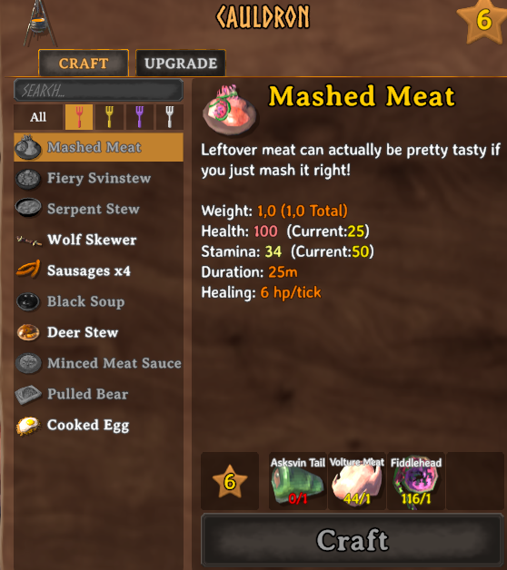

# WorkbenchSearchFilters

A BepInEx mod for Valheim that adds a search box and category filters (weapons, armor, tools, consumables, materials, misc) to the recipe list of every crafting station: workbench, forge, black forge, cauldron, artisan table, galdr table... and hand crafting too.

[Versión en español](README.es.md)







## Features

- **Search box** above the recipe list: filters as you type by the item's name in the current game language. Case and accents are ignored ("pocion" finds "Poción").
- **Category buttons:** All, Weapons, Armor, Tools, Consumables, Materials, Misc. Each button shows its name on hover. Categories with no recipes at the current station are hidden, and those with no results for the current search are dimmed.
- **Food filters at the cauldron and the food preparation table:** health, stamina, eitr and balanced food, each sorted from most to least health, stamina or eitr (see [Food filters](#food-filters)).
- **Typing doesn't control the game:** while the search box has focus, your character doesn't move and keys like E or Tab don't close the inventory.
- **Works in both Craft and Upgrade tabs**, at every station, including modded ones.
- **Translated:** follows the game language, also when changed in Settings. 22 languages: English, Spanish, German, French, Italian, Portuguese (Brazil and Portugal), Russian, Ukrainian, Polish, Czech, Dutch, Swedish, Norwegian, Danish, Finnish, Turkish, Hungarian, Chinese (simplified and traditional), Japanese and Korean. Any other language falls back to English.
- **Client-side only:** nothing is needed on the server, and other players don't need the mod.

## Categories

Items are sorted by their own game data, so items added by other mods are categorised automatically:

| Category | What goes in it |
|---|---|
| Weapons | Swords, axes, maces, spears, atgeirs, knives, bows, crossbows, staffs... |
| Armor | Helmets, chest and leg armor, capes, shields, belts, trinkets |
| Tools | Hammer, hoe, cultivator, pickaxes, fishing rod, torches |
| Consumables | Food, meads, arrows, bolts, bait, bombs, and ingredients for the oven, cooking station or fermenter (bread dough, uncooked pies, mead bases) |
| Materials | Crafting materials |
| Misc | Everything else (tankards, etc.) |

Every time you enter a world, `BepInEx/config/WorkbenchSearchFilters.adrirf7.Categories.txt` lists every craftable item with its prefab name and category. To move an item, add `Prefab:Category` to `CategoryOverrides` in the config file.

## Food filters


At the cauldron and the food preparation table, the category buttons are replaced by food filters, marked with a colored fork:

| Filter | Fork | What goes in it |
|---|---|---|
| Health food | Red | Food whose health is more than double its stamina |
| Stamina food | Yellow | Food whose stamina is more than double its health |
| Eitr food | Purple | Food whose eitr is more than double its health and its stamina |
| Balanced food | White | Everything else (health and stamina are close) |
| Meads | Mead icon | Mead bases and other non-food items |

This is the same rule the game uses to color the food marker in the inventory. Inside each food filter, recipes are sorted from most to least health, stamina or eitr (balanced food: health + stamina). Uncooked food (bread dough, uncooked pies...) is classified and sorted by the food it becomes once cooked.

## Configuration

`BepInEx/config/WorkbenchSearchFilters.adrirf7.cfg`, created the first time the mod loads:

- `ClearSearchOnClose` (default `true`): clear the search text when the inventory is closed.
- `RememberCategory` (default `true`): keep the selected category between openings.
- `CategoryOverrides`: force the category of specific items, as `Prefab:Category` separated by commas. Categories: `Weapons`, `Armor`, `Tools`, `Consumables`, `Materials`, `Misc`; at the cauldron and the food preparation table: `FoodHealth`, `FoodStamina`, `FoodEitr`, `FoodBalanced`, `Meads`, `Misc`.

## How it works

The code only uses Harmony patches and Unity UI components. It does not access the network or any files outside the game process, except for writing its own config file and `WorkbenchSearchFilters.adrirf7.Categories.txt` in `BepInEx/config`.

- `src/FilterBar.cs`: builds the search box (a copy of the build menu's search field) and the category buttons on top of the recipe list, and filters the list. The game builds the list once; searching or changing category only hides and shows existing rows.
- `src/Categories.cs`: decides each item's category from its item type, food stats, attack data and the game's cooking stations, and writes the category report.
- `src/Patches.cs`: Harmony patches on `InventoryGui.UpdateRecipeList` (filtering), `InventoryGui.Hide` (reset on close) and `Chat.HasFocus` (blocks game input while typing).
- `src/Translations.cs`: registers the mod's text with Valheim's localization.
- `src/Plugin.cs`: BepInEx entry point and configuration.

## Building

Requirements:

- [.NET SDK 8](https://dotnet.microsoft.com/download) or newer
- Valheim with [BepInExPack Valheim](https://thunderstore.io/c/valheim/p/denikson/BepInExPack_Valheim/) installed (the project references the game's and BepInEx's assemblies from the install folder)

Steps:

```
git clone https://github.com/adrirf7/WorkbenchSearch-Filters
cd WorkbenchSearch-Filters
dotnet build -c Release -p:ValheimDir="C:\Program Files (x86)\Steam\steamapps\common\Valheim" -p:DeployToGame=false
```

The compiled mod is `bin/Release/WorkbenchSearchFilters.dll`. `ValheimDir` defaults to the Steam path above. Release builds also create the Nexus Mods and Thunderstore zips in `release/`. Without `-p:DeployToGame=false`, the build also copies the DLL and its `.pdb` to `BepInEx/scripts/` in that Valheim install, where [ScriptEngine](https://github.com/BepInEx/BepInEx.Debug) loads it and reloads it whenever it changes (hot reload while the game is running).

The NuGet package `BepInEx.AssemblyPublicizer.MSBuild` is restored automatically. It lets the code access non-public members of `assembly_valheim.dll` at compile time, which is standard practice for Valheim mods.

## Installation

1. Install BepInExPack Valheim.
2. Put `WorkbenchSearchFilters.dll` in `BepInEx/plugins/WorkbenchSearchFilters/`.

## Changelog

- **1.1.0:** food filters at the cauldron and the food preparation table (health, stamina, eitr and balanced food, each sorted by its stat, plus meads); categories with no recipes at the current station are hidden; new armor icon (red and white banded shield); removed the leftover "F" key hint next to the search box; the mod can be reloaded with ScriptEngine without duplicating the filter bar.
- **1.0.1:** fixed recipes overlapping in the Recycle tab of Valheim Recycle (the filter now runs after other mods rebuild the list).
- **1.0.0:** first release.
